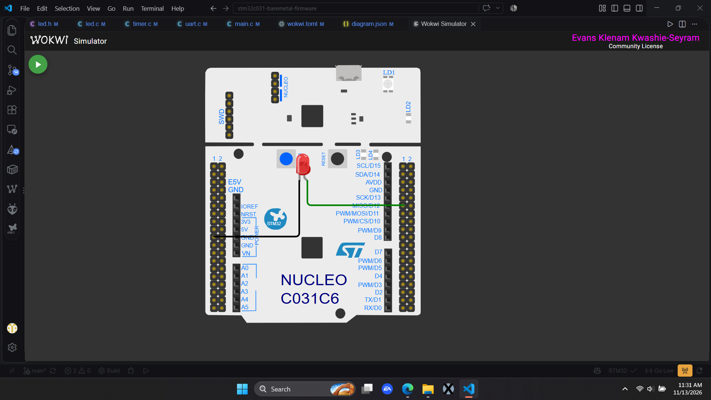

# STM32C031 Bare-Metal Firmware

A register-level embedded firmware project for the **STM32C031x6** microcontroller, developed in C using CMSIS and the GNU Arm Embedded Toolchain.

The project explores low-level peripheral configuration and firmware development without relying on the STM32 HAL. It currently implements GPIO control, timer interrupts, and a UART-based command interface, with a Wokwi simulation configuration for the NUCLEO-C031C6.

## Features

- **Bare-metal peripheral access:** Direct configuration of STM32 peripheral registers using CMSIS device definitions.
- **GPIO control:** Configure PA5 as an output and control an external LED.
- **UART communication:** Register-level USART1 initialization, character transmission, and reception.
- **UART command interface:** Execute LED commands and inspect timer status through a serial terminal.
- **Timer interrupts:** Configure TIM3 to generate update interrupts and maintain software event flags.
- **Input handling:** Support CR, LF, and CRLF line endings, command echoing, and command-buffer overflow detection.
- **Cross-compilation:** CMake-based build system using GNU Arm Embedded GCC.
- **Simulation:** Wokwi project configuration targeting the NUCLEO-C031C6.

## Hardware Configuration

The firmware targets the STM32C031x6 microcontroller and is configured for simulation using the NUCLEO-C031C6 board.

| Peripheral | Pin / Resource | Function |
|---|---|---|
| GPIOA | PA5 | External LED output |
| USART1 | PA9 | UART transmit |
| USART1 | PA10 | UART receive |
| TIM3 | Internal peripheral | Periodic timer interrupts |

## Wokwi Simulation

The project includes a Wokwi simulation using the STM32 NUCLEO-C031C6.



> Note: UART terminal communication is still under investigation. The simulation setup is included for visual reference.

### Wokwi Connections

The simulation diagram connects:

- PA5 to the external LED anode.
- GND to the LED cathode.
- PA9 to the serial monitor RX.
- PA10 to the serial monitor TX.

## UART Command Interface

After initialization, the firmware sends:

```text
UART ready
```

Commands are entered through the Wokwi serial monitor or a compatible UART terminal.

| Command | Description |
|---|---|
| `led on` | Turns on the external LED |
| `led off` | Turns off the external LED |
| `status` | Reports whether TIM3 is running |

The command handler supports:

- Character-by-character input.
- Command echoing.
- Null-terminated command strings.
- CR, LF, and CRLF line endings.
- Detection and reporting of commands exceeding the input buffer capacity.

Example interaction:

```text
UART ready
led on
led off
status
Timer: running
```

## Timer Configuration

TIM3 is configured directly through its peripheral registers.

```c
TIM3->PSC = 4799;
TIM3->ARR = 999;
```

The timer update interrupt is enabled through the TIM3 interrupt handler and NVIC.

The implementation maintains two event flags:

- `timer_event`: Set on each timer update interrupt.
- `one_second_event`: Set after ten timer update events.

The timer module exposes functions to retrieve these event flags and inspect timer status register values.

The actual interrupt interval depends on the TIM3 input clock frequency.

## Project Structure

```text
stm32c031-baremetal-firmware/
│
├── cmake/
│   ├── components.cmake
│   ├── files.cmake
│   ├── flags.cmake
│   ├── gcc-arm-none-eabi.cmake
│   └── target.cmake
│
├── Drivers/
│   └── CMSIS/
│       ├── Core/
│       └── Device/
│
├── Inc/
│   ├── led.h
│   ├── timer.h
│   └── uart.h
│
├── Src/
│   ├── led.c
│   ├── main.c
│   ├── startup_stm32c031xx.S
│   ├── syscall.c
│   ├── sysmem.c
│   ├── timer.c
│   └── uart.c
│
├── CMakeLists.txt
├── CMakePresets.json
├── diagram.json
├── project-description.json
├── stm32c031x6_flash.ld
└── wokwi.toml
```

## Building the Firmware

### Prerequisites

The build environment requires:

- CMake 3.20 or later.
- Ninja build system.
- GNU Arm Embedded Toolchain (`arm-none-eabi-gcc`).
- WSL with Ubuntu or another compatible Linux environment.

On Ubuntu, the required packages can be installed with:

```bash
sudo apt update
sudo apt install cmake ninja-build gcc-arm-none-eabi
```

### Configure

Clone the repository:

```bash
git clone https://github.com/Evans-Kwashie/stm32c031-baremetal-firmware.git
cd stm32c031-baremetal-firmware
```

Configure the project:

```bash
cmake -S . -B build-wsl -G Ninja
```

### Compile

```bash
cmake --build build-wsl
```

The resulting ELF firmware image is generated at:

```text
build-wsl/stm32c031-baremetal-firmware.elf
```

### Inspect Firmware Size

```bash
arm-none-eabi-size build-wsl/stm32c031-baremetal-firmware.elf
```

## Build Verification

The firmware has been successfully cross-compiled using:

| Component | Version |
|---|---|
| GNU Arm Embedded GCC | 13.2.1 |
| CMake | 3.28.3 |
| Ninja | 1.11.1 |
| Target architecture | ARM Cortex-M0+ |

Recorded build output:

| Section | Size |
|---|---:|
| `.text` | 2,281 bytes |
| `.data` | 308 bytes |
| `.bss` | 748 bytes |

These figures represent one successful build and may change as the firmware develops.

## Wokwi Simulation

The project includes:

- `diagram.json` — board, LED, and serial monitor connections.
- `wokwi.toml` — simulation configuration pointing to the generated ELF firmware.

The configured firmware path is:

```toml
[wokwi]
version = 1
firmware = "build-wsl/stm32c031-baremetal-firmware.elf"
elf = "build-wsl/stm32c031-baremetal-firmware.elf"
```

Build the firmware before starting the Wokwi simulation.

## Development Goals

This project is intended to strengthen practical understanding of:

- ARM Cortex-M microcontroller architecture.
- Memory-mapped peripheral registers.
- GPIO configuration and output control.
- UART communication and command parsing.
- Timer configuration and interrupt handling.
- NVIC interrupt management.
- Embedded C and cross-compilation workflows.

## Future Improvements

- Add configurable system clock initialization.
- Derive UART baud-rate configuration from the peripheral clock.
- Integrate timer events into the main application loop.
- Add command responses for unsupported commands.
- Expand peripheral support with additional interfaces.

---

**Repository:** [stm32c031-baremetal-firmware](https://github.com/Evans-Kwashie/stm32c031-baremetal-firmware)

**Author:** Evans Klenam Kwashie-Seyram
